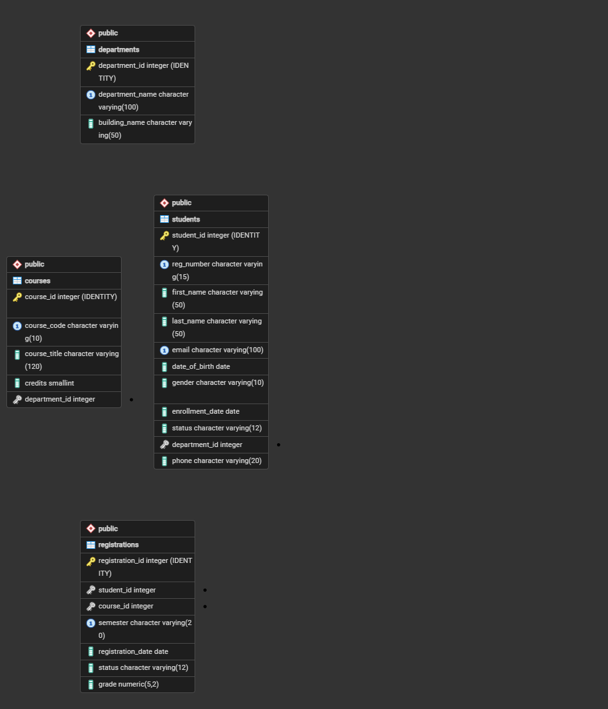

# Assignment III: SQL Table Manipulation - Student Registration System

## Section 1: Project Overview

| Item | Detail |
|---|---|
| Project title | Student Registration System |
| Student name | DAUGLA DOURAH NGUEMADJIMBAYE |
| Student ID | 202512707 |
| Business idea | A university needs a small relational database to record its departments, the courses each department offers, the students enrolled, and which students register for which courses each semester. |
| DBMS | PostgreSQL |
| Database name | `daugla_202512707_student_registration` |

## Section 2: Database and Table Design

**Database name:** `daugla_202512707_student_registration` (format `yourname_studentid_projectname`).

### Table `departments`

Faculties or departments of the university. Parent table.

| Column | Data type | Constraints |
|---|---|---|
| department_id | INT | PRIMARY KEY, generated automatically (IDENTITY) |
| department_name | VARCHAR(100) | NOT NULL, UNIQUE |
| building | VARCHAR(50) | NOT NULL (renamed to building_name in Q4.1) |

### Table `courses`

Courses offered by a department. Child of departments.

| Column | Data type | Constraints |
|---|---|---|
| course_id | INT | PRIMARY KEY, IDENTITY |
| course_code | VARCHAR(10) | NOT NULL, UNIQUE |
| course_title | VARCHAR(120) | NOT NULL |
| credits | INT | NOT NULL, CHECK between 1 and 6 (changed to SMALLINT in Q4.2) |
| department_id | INT | NOT NULL, FOREIGN KEY to departments |

### Table `students`

Students registered at the university. Child of departments.

| Column | Data type | Constraints |
|---|---|---|
| student_id | INT | PRIMARY KEY, IDENTITY |
| reg_number | VARCHAR(15) | NOT NULL, UNIQUE |
| first_name / last_name | VARCHAR(50) | NOT NULL |
| email | VARCHAR(100) | NOT NULL, UNIQUE |
| date_of_birth | DATE | NOT NULL, CHECK after 1950-01-01 |
| gender | VARCHAR(10) | NOT NULL, CHECK Male or Female |
| enrollment_date | DATE | NOT NULL, DEFAULT CURRENT_DATE |
| status | VARCHAR(12) | NOT NULL, DEFAULT 'Active', CHECK Active / Suspended / Graduated |
| department_id | INT | NOT NULL, FOREIGN KEY to departments |
| phone | VARCHAR(20) | added in Q4.3 |

### Table `registrations`

Which student registered for which course in which semester. Child of students and courses.

| Column | Data type | Constraints |
|---|---|---|
| registration_id | INT | PRIMARY KEY, IDENTITY |
| student_id | INT | NOT NULL, FOREIGN KEY to students |
| course_id | INT | NOT NULL, FOREIGN KEY to courses |
| semester | VARCHAR(20) | NOT NULL |
| registration_date | DATE | NOT NULL, DEFAULT CURRENT_DATE |
| status | VARCHAR(12) | NOT NULL, DEFAULT 'Registered', CHECK Registered / Dropped / Completed / Failed |
| grade | NUMERIC(5,2) | CHECK between 0 and 100 (NULL until a grade is posted) |

### Primary keys and foreign keys

A **primary key** uniquely identifies each row of a table. Every table has one (`department_id`, `course_id`, `student_id`, `registration_id`) and it is generated automatically with `GENERATED ALWAYS AS IDENTITY`, so no value is typed manually.

A **foreign key** is a column that holds the primary-key value of a row in another table. The database refuses a value that does not exist in the parent table, which prevents orphan records.

| Foreign key | Child table | Parent table | Purpose |
|---|---|---|---|
| `fk_courses_department` | courses.department_id | departments.department_id | Each course is offered by one department |
| `fk_students_department` | students.department_id | departments.department_id | Each student belongs to one department |
| `fk_registrations_student` | registrations.student_id | students.student_id | A registration belongs to an existing student |
| `fk_registrations_course` | registrations.course_id | courses.course_id | A registration refers to an existing course |

### Entity-Relationship Diagram (generated by pgAdmin 4)



### Relationships between the tables

* **departments to courses (one to many):** a department offers many courses, but each course is offered by one department.
* **departments to students (one to many):** a department has many students, and each student belongs to one department.
* **students to courses (many to many):** a student registers for many courses and a course has many students. A many-to-many link cannot be stored in one column, so the table `registrations` sits between them and holds one row per student, course and semester (with its own status and grade).

These relationships avoid duplication: the department name is stored once in `departments`, and a student's or course's details are stored once, then referred to by id. The UNIQUE constraint on (student_id, course_id, semester) also stops the same registration being entered twice.

## Section 3: Database and Table Creation

**Database creation** (run while connected to `postgres`):

```sql
CREATE DATABASE daugla_202512707_student_registration;
```

```
CREATE DATABASE
```


**Table creation** (parent tables first), with primary keys, foreign keys and other constraints:

```sql
CREATE TABLE departments (
    department_id    INT GENERATED ALWAYS AS IDENTITY PRIMARY KEY,
    department_name  VARCHAR(100) NOT NULL UNIQUE,
    building         VARCHAR(50)  NOT NULL
);

CREATE TABLE courses (
    course_id      INT GENERATED ALWAYS AS IDENTITY PRIMARY KEY,
    course_code    VARCHAR(10)  NOT NULL UNIQUE,
    course_title   VARCHAR(120) NOT NULL,
    credits        INT          NOT NULL CHECK (credits BETWEEN 1 AND 6),
    department_id  INT          NOT NULL,
    CONSTRAINT fk_courses_department
        FOREIGN KEY (department_id) REFERENCES departments (department_id)
);

CREATE TABLE students (
    student_id       INT GENERATED ALWAYS AS IDENTITY PRIMARY KEY,
    reg_number       VARCHAR(15)  NOT NULL UNIQUE,
    first_name       VARCHAR(50)  NOT NULL,
    last_name        VARCHAR(50)  NOT NULL,
    email            VARCHAR(100) NOT NULL UNIQUE,
    date_of_birth    DATE         NOT NULL CHECK (date_of_birth > DATE '1950-01-01'),
    gender           VARCHAR(10)  NOT NULL CHECK (gender IN ('Male', 'Female')),
    enrollment_date  DATE         NOT NULL DEFAULT CURRENT_DATE,
    status           VARCHAR(12)  NOT NULL DEFAULT 'Active'
                     CHECK (status IN ('Active', 'Suspended', 'Graduated')),
    department_id    INT          NOT NULL,
    CONSTRAINT fk_students_department
        FOREIGN KEY (department_id) REFERENCES departments (department_id)
);

CREATE TABLE registrations (
    registration_id    INT GENERATED ALWAYS AS IDENTITY PRIMARY KEY,
    student_id         INT          NOT NULL,
    course_id          INT          NOT NULL,
    semester           VARCHAR(20)  NOT NULL,
    registration_date  DATE         NOT NULL DEFAULT CURRENT_DATE,
    status             VARCHAR(12)  NOT NULL DEFAULT 'Registered'
                       CHECK (status IN ('Registered', 'Dropped', 'Completed', 'Failed')),
    grade              NUMERIC(5,2) CHECK (grade BETWEEN 0 AND 100),
    CONSTRAINT fk_registrations_student
        FOREIGN KEY (student_id) REFERENCES students (student_id),
    CONSTRAINT fk_registrations_course
        FOREIGN KEY (course_id) REFERENCES courses (course_id),
    CONSTRAINT uq_student_course_semester UNIQUE (student_id, course_id, semester)
);
```

```
CREATE TABLE
CREATE TABLE
CREATE TABLE
CREATE TABLE
```


## Section 4: Initial Data Insertion

Parent tables are filled first. Primary-key columns are not listed, so PostgreSQL generates them.

```sql
-- Parent table first: departments (department_id is generated automatically)
INSERT INTO departments (department_name, building) VALUES
('Computer Science',        'Block A'),
('Business Administration', 'Block B'),
('Law',                     'Block C'),
('Education',               'Block D'),
('Public Health',           'Block E');

-- Courses (child of departments). department_id 1..5 = the departments inserted above, in order.
INSERT INTO courses (course_code, course_title, credits, department_id) VALUES
('CS101',  'Introduction to Programming', 4, 1),
('CS201',  'Database Systems',            3, 1),
('BA101',  'Principles of Management',    3, 2),
('LAW101', 'Introduction to Law',         3, 3),
('EDU105', 'Educational Psychology',      2, 4);

-- Students (child of departments)
INSERT INTO students (reg_number, first_name, last_name, email, date_of_birth, gender, enrollment_date, status, department_id) VALUES
('REG-2022-001', 'Jean Claude', 'Habimana',  'jc.habimana@example.com', '2000-03-14', 'Male',   '2022-09-05', 'Active',    1),
('REG-2022-002', 'Aline',       'Uwase',     'aline.uwase@example.com', '2001-07-22', 'Female', '2022-09-05', 'Active',    2),
('REG-2024-001', 'Patrick',     'Niyonzima', 'p.niyonzima@example.com', '2004-05-18', 'Male',   '2024-09-02', 'Active',    1),
('REG-2025-001', 'Sandrine',    'Uwimana',   's.uwimana@example.com',   '2004-09-09', 'Female', '2025-09-01', 'Active',    2),
('REG-2026-001', 'Claudine',    'Mutesi',    'c.mutesi@example.com',    '2005-12-25', 'Female', '2026-01-12', 'Suspended', 3);

-- Registrations (child of students AND courses). student_id 1..5 and course_id 1..5 as inserted above.
INSERT INTO registrations (student_id, course_id, semester, registration_date, status, grade) VALUES
(1, 1, 'Semester 1 2026', '2026-01-20', 'Completed',  78.50),
(1, 2, 'Semester 1 2026', '2026-01-20', 'Completed',  82.00),
(2, 3, 'Semester 1 2026', '2026-01-21', 'Registered', 67.25),
(3, 1, 'Semester 1 2026', '2026-01-23', 'Registered', 45.50),
(4, 3, 'Semester 1 2026', '2026-01-24', 'Registered', 64.00);
```

```
INSERT 0 5
INSERT 0 5
INSERT 0 5
INSERT 0 5
```


**Evidence: every table has at least five records**

```sql
SELECT 'departments' AS table_name, COUNT(*) AS total_rows FROM departments
UNION ALL SELECT 'courses',       COUNT(*) FROM courses
UNION ALL SELECT 'students',      COUNT(*) FROM students
UNION ALL SELECT 'registrations', COUNT(*) FROM registrations;
```

```
  table_name   | total_rows 
---------------+------------
 departments   |          5
 courses       |          5
 students      |          5
 registrations |          5
(4 rows)
```


**Evidence: automatically generated primary keys**

```sql
SELECT department_id, department_name, building FROM departments ORDER BY department_id;
```

```
 department_id |     department_name     | building 
---------------+-------------------------+----------
             1 | Computer Science        | Block A
             2 | Business Administration | Block B
             3 | Law                     | Block C
             4 | Education               | Block D
             5 | Public Health           | Block E
(5 rows)
```

The ids 1 to 5 were generated by the database; none was inserted manually.

**Evidence: foreign-key relationships work (no orphan rows)**

```sql
-- Foreign-key check: rows whose parent does not exist (every result must be 0)
SELECT
  (SELECT COUNT(*) FROM courses c       LEFT JOIN departments d ON d.department_id = c.department_id WHERE d.department_id IS NULL) AS courses_without_department,
  (SELECT COUNT(*) FROM students s      LEFT JOIN departments d ON d.department_id = s.department_id WHERE d.department_id IS NULL) AS students_without_department,
  (SELECT COUNT(*) FROM registrations r LEFT JOIN students s    ON s.student_id    = r.student_id    WHERE s.student_id IS NULL)    AS registrations_without_student,
  (SELECT COUNT(*) FROM registrations r LEFT JOIN courses c     ON c.course_id     = r.course_id     WHERE c.course_id IS NULL)     AS registrations_without_course;
```

```
 courses_without_department | students_without_department | registrations_without_student | registrations_without_course 
----------------------------+-----------------------------+-------------------------------+------------------------------
                          0 |                           0 |                             0 |                            0
(1 row)
```

## Section 5: SQL Practical Tasks

### Q1.1 - Q1.3: SELECT

#### Q1.1: Basic Data Retrieval

**Objective:** Display the registration number, name and email of every student, choosing only the columns that are useful.

**Execute**

```sql
SELECT reg_number, first_name, last_name, email
FROM students;
```

**Result:**

```
  reg_number  | first_name  | last_name |          email          
--------------+-------------+-----------+-------------------------
 REG-2022-001 | Jean Claude | Habimana  | jc.habimana@example.com
 REG-2022-002 | Aline       | Uwase     | aline.uwase@example.com
 REG-2024-001 | Patrick     | Niyonzima | p.niyonzima@example.com
 REG-2025-001 | Sandrine    | Uwimana   | s.uwimana@example.com
 REG-2026-001 | Claudine    | Mutesi    | c.mutesi@example.com
(5 rows)
```


**Explanation:** The query reads only four columns from the students table instead of using SELECT *. All 5 initial students are returned, which gives the registrar a simple contact list.

#### Q1.2: Conditional Data Retrieval

**Objective:** List the active students who were born on or after 1 January 2004.

**Execute**

```sql
SELECT reg_number, first_name, last_name, date_of_birth, status
FROM students
WHERE status = 'Active'
  AND date_of_birth >= '2004-01-01';
```

**Result:**

```
  reg_number  | first_name | last_name | date_of_birth | status 
--------------+------------+-----------+---------------+--------
 REG-2024-001 | Patrick    | Niyonzima | 2004-05-18    | Active
 REG-2025-001 | Sandrine   | Uwimana   | 2004-09-09    | Active
(2 rows)
```


**Explanation:** WHERE combines two conditions with AND, so a row must satisfy both. Two students match; Claudine Mutesi (REG-2026-001) was also born after 2004 but is Suspended, so she is excluded.

#### Q1.3: Sorted Data Retrieval

**Objective:** List the courses from the highest to the lowest number of credits.

**Execute**

```sql
SELECT course_code, course_title, credits
FROM courses
ORDER BY credits DESC, course_code ASC;
```

**Result:**

```
 course_code |        course_title         | credits 
-------------+-----------------------------+---------
 CS101       | Introduction to Programming |       4
 BA101       | Principles of Management    |       3
 CS201       | Database Systems            |       3
 LAW101      | Introduction to Law         |       3
 EDU105      | Educational Psychology      |       2
(5 rows)
```


**Explanation:** ORDER BY credits DESC puts the 4-credit course first. Course code is a second sort key (ASC), so courses with equal credits appear in alphabetical order.

### Q2.1 - Q2.3: JOIN

#### Q2.1: INNER JOIN

**Objective:** Show each student together with the name of their department.

**Execute**

```sql
SELECT s.reg_number, s.first_name, s.last_name, d.department_name
FROM students s
INNER JOIN departments d ON d.department_id = s.department_id
ORDER BY d.department_name, s.last_name;
```

**Result:**

```
  reg_number  | first_name  | last_name |     department_name     
--------------+-------------+-----------+-------------------------
 REG-2022-002 | Aline       | Uwase     | Business Administration
 REG-2025-001 | Sandrine    | Uwimana   | Business Administration
 REG-2022-001 | Jean Claude | Habimana  | Computer Science
 REG-2024-001 | Patrick     | Niyonzima | Computer Science
 REG-2026-001 | Claudine    | Mutesi    | Law
(5 rows)
```


**Explanation:** INNER JOIN keeps only rows that match in both tables, using the foreign key students.department_id. All 5 students appear because each one belongs to an existing department.

#### Q2.2: LEFT JOIN

**Objective:** Show every course with the number of registrations it has, including courses nobody has registered for.

**Execute**

```sql
SELECT c.course_code, c.course_title, COUNT(r.registration_id) AS total_registrations
FROM courses c
LEFT JOIN registrations r ON r.course_id = c.course_id
GROUP BY c.course_id, c.course_code, c.course_title
ORDER BY total_registrations DESC, c.course_code;
```

**Result:**

```
 course_code |        course_title         | total_registrations 
-------------+-----------------------------+---------------------
 BA101       | Principles of Management    |                   2
 CS101       | Introduction to Programming |                   2
 CS201       | Database Systems            |                   1
 EDU105      | Educational Psychology      |                   0
 LAW101      | Introduction to Law         |                   0
(5 rows)
```


**Explanation:** LEFT JOIN keeps all 5 courses even when no registration matches. LAW101 and EDU105 show 0 registrations; an INNER JOIN would have removed both from the report.

#### Q2.3: Multi-Table JOIN

**Objective:** Produce a registration report joining four tables: registrations, students, courses and the department that offers each course.

**Execute**

```sql
SELECT s.reg_number,
       s.first_name || ' ' || s.last_name AS student,
       c.course_code,
       c.course_title,
       d.department_name AS course_department,
       r.semester,
       r.status,
       r.grade
FROM registrations r
JOIN students s    ON s.student_id    = r.student_id
JOIN courses c     ON c.course_id     = r.course_id
JOIN departments d ON d.department_id = c.department_id
ORDER BY r.semester, s.last_name, c.course_code;
```

**Result:**

```
  reg_number  |       student        | course_code |        course_title         |    course_department    |    semester     |   status   | grade 
--------------+----------------------+-------------+-----------------------------+-------------------------+-----------------+------------+-------
 REG-2022-001 | Jean Claude Habimana | CS101       | Introduction to Programming | Computer Science        | Semester 1 2026 | Completed  | 78.50
 REG-2022-001 | Jean Claude Habimana | CS201       | Database Systems            | Computer Science        | Semester 1 2026 | Completed  | 82.00
 REG-2024-001 | Patrick Niyonzima    | CS101       | Introduction to Programming | Computer Science        | Semester 1 2026 | Registered | 45.50
 REG-2022-002 | Aline Uwase          | BA101       | Principles of Management    | Business Administration | Semester 1 2026 | Registered | 67.25
 REG-2025-001 | Sandrine Uwimana     | BA101       | Principles of Management    | Business Administration | Semester 1 2026 | Registered | 64.00
(5 rows)
```


**Explanation:** The registrations table links students and courses, and courses link to departments, so three JOINs combine four tables into one readable report. It returns all 5 registrations with the student, course, offering department, status and grade.

### Q3.1 - Q3.3: UPDATE

#### Q3.1: Update One Record

**Objective:** Change the email address of one student, identified by the unique registration number REG-2024-001.

**Identify the record (before)**

```sql
SELECT student_id, reg_number, first_name, last_name, email
FROM students
WHERE reg_number = 'REG-2024-001';
```

**Result:**

```
 student_id |  reg_number  | first_name | last_name |          email          
------------+--------------+------------+-----------+-------------------------
          3 | REG-2024-001 | Patrick    | Niyonzima | p.niyonzima@example.com
(1 row)
```


**Execute the update**

```sql
UPDATE students
SET email = 'patrick.niyonzima@example.com'
WHERE reg_number = 'REG-2024-001';
```

**Result:**

```
UPDATE 1
```

**Verify the change (after)**

```sql
SELECT student_id, reg_number, first_name, last_name, email
FROM students
WHERE reg_number = 'REG-2024-001';
```

**Result:**

```
 student_id |  reg_number  | first_name | last_name |             email             
------------+--------------+------------+-----------+-------------------------------
          3 | REG-2024-001 | Patrick    | Niyonzima | patrick.niyonzima@example.com
(1 row)
```


**Explanation:** Filtering on the unique reg_number guarantees that exactly one row changes (the command reports UPDATE 1). The second SELECT confirms the new email while the other columns are untouched.

#### Q3.2: Update Multiple Records

**Objective:** Mark as Graduated every active student who enrolled before 2023 (the 2022 intake that has finished its final semester).

**Identify the records (before)**

```sql
SELECT reg_number, first_name, last_name, enrollment_date, status
FROM students
WHERE enrollment_date < '2023-01-01'
  AND status = 'Active';
```

**Result:**

```
  reg_number  | first_name  | last_name | enrollment_date | status 
--------------+-------------+-----------+-----------------+--------
 REG-2022-001 | Jean Claude | Habimana  | 2022-09-05      | Active
 REG-2022-002 | Aline       | Uwase     | 2022-09-05      | Active
(2 rows)
```


**Execute the update**

```sql
UPDATE students
SET status = 'Graduated'
WHERE enrollment_date < '2023-01-01'
  AND status = 'Active';
```

**Result:**

```
UPDATE 2
```

**Verify the change (after)**

```sql
SELECT reg_number, first_name, last_name, enrollment_date, status
FROM students
WHERE enrollment_date < '2023-01-01';
```

**Result:**

```
  reg_number  | first_name  | last_name | enrollment_date |  status   
--------------+-------------+-----------+-----------------+-----------
 REG-2022-001 | Jean Claude | Habimana  | 2022-09-05      | Graduated
 REG-2022-002 | Aline       | Uwase     | 2022-09-05      | Graduated
(2 rows)
```


**Explanation:** The same WHERE condition was tested with a SELECT first, so I knew that 2 students would change. The update reports UPDATE 2 and the verification shows both as Graduated, while students enrolled later are unchanged.

#### Q3.3: Conditional Update

**Objective:** Apply the business rule: once a grade is posted, a registration with grade 50 or more becomes Completed, and below 50 becomes Failed.

**Identify the records (before)**

```sql
SELECT registration_id, student_id, course_id, grade, status
FROM registrations
WHERE status = 'Registered'
  AND grade IS NOT NULL
ORDER BY registration_id;
```

**Result:**

```
 registration_id | student_id | course_id | grade |   status   
-----------------+------------+-----------+-------+------------
               3 |          2 |         3 | 67.25 | Registered
               4 |          3 |         1 | 45.50 | Registered
               5 |          4 |         3 | 64.00 | Registered
(3 rows)
```


**Execute the update**

```sql
UPDATE registrations
SET status = CASE
                WHEN grade >= 50 THEN 'Completed'
                ELSE 'Failed'
            END
WHERE status = 'Registered'
  AND grade IS NOT NULL;
```

**Result:**

```
UPDATE 3
```

**Verify the change (after)**

```sql
SELECT registration_id, student_id, course_id, grade, status
FROM registrations
WHERE grade IS NOT NULL
ORDER BY registration_id;
```

**Result:**

```
 registration_id | student_id | course_id | grade |  status   
-----------------+------------+-----------+-------+-----------
               1 |          1 |         1 | 78.50 | Completed
               2 |          1 |         2 | 82.00 | Completed
               3 |          2 |         3 | 67.25 | Completed
               4 |          3 |         1 | 45.50 | Failed
               5 |          4 |         3 | 64.00 | Completed
(5 rows)
```


**Explanation:** CASE applies the pass mark row by row. Three registrations had a grade but were still Registered; two (67.25 and 64.00) became Completed and one (45.50) became Failed. The WHERE clause protected the two registrations that were already Completed.

### Q4.1 - Q4.3: ALTER TABLE

#### Q4.1: Rename a Column

**Objective:** Rename departments.building to building_name so the column name is more descriptive.

**Execute**

```sql
ALTER TABLE departments
RENAME COLUMN building TO building_name;
```

**Result:**

```
ALTER TABLE
```

**Verify the new name**

```sql
SELECT column_name, data_type
FROM information_schema.columns
WHERE table_name = 'departments'
ORDER BY ordinal_position;
```

**Result:**

```
   column_name   |     data_type     
-----------------+-------------------
 department_id   | integer
 department_name | character varying
 building_name   | character varying
(3 rows)
```


**Verify the data is still accessible**

```sql
SELECT department_name, building_name
FROM departments
ORDER BY department_name;
```

**Result:**

```
     department_name     | building_name 
-------------------------+---------------
 Business Administration | Block B
 Computer Science        | Block A
 Education               | Block D
 Law                     | Block C
 Public Health           | Block E
(5 rows)
```

**Explanation:** RENAME COLUMN changes only the name; the data type and the stored values stay the same. information_schema shows building_name and the SELECT proves the five buildings are still readable under the new name.

#### Q4.2: Change a Column's Data Type

**Objective:** Change courses.credits from INT to SMALLINT, because credits are small numbers between 1 and 6.

**Check that the values convert safely**

```sql
SELECT MIN(credits) AS smallest, MAX(credits) AS largest
FROM courses;
```

**Result:**

```
 smallest | largest 
----------+---------
        2 |       4
(1 row)
```

**Execute**

```sql
ALTER TABLE courses
ALTER COLUMN credits TYPE SMALLINT;
```

**Result:**

```
ALTER TABLE
```

**Verify the new structure**

```sql
SELECT column_name, data_type
FROM information_schema.columns
WHERE table_name = 'courses'
ORDER BY ordinal_position;
```

**Result:**

```
  column_name  |     data_type     
---------------+-------------------
 course_id     | integer
 course_code   | character varying
 course_title  | character varying
 credits       | smallint
 department_id | integer
(5 rows)
```


**Verify the data is still valid**

```sql
SELECT course_code, course_title, credits
FROM courses
ORDER BY course_code;
```

**Result:**

```
 course_code |        course_title         | credits 
-------------+-----------------------------+---------
 BA101       | Principles of Management    |       3
 CS101       | Introduction to Programming |       4
 CS201       | Database Systems            |       3
 EDU105      | Educational Psychology      |       2
 LAW101      | Introduction to Law         |       3
(5 rows)
```

**Explanation:** The existing values are between 2 and 4, far inside the SMALLINT range, so the conversion is safe. The structure now shows smallint and all five courses keep their original credits and their CHECK constraint.

#### Q4.3: Add a Column

**Objective:** Add a phone column to students so the registrar can contact students by telephone.

**Execute**

```sql
ALTER TABLE students
ADD COLUMN phone VARCHAR(20);
```

**Result:**

```
ALTER TABLE
```

**Verify the new structure**

```sql
SELECT column_name, data_type, character_maximum_length
FROM information_schema.columns
WHERE table_name = 'students'
ORDER BY ordinal_position;
```

**Result:**

```
   column_name   |     data_type     | character_maximum_length 
-----------------+-------------------+--------------------------
 student_id      | integer           |                         
 reg_number      | character varying |                       15
 first_name      | character varying |                       50
 last_name       | character varying |                       50
 email           | character varying |                      100
 date_of_birth   | date              |                         
 gender          | character varying |                       10
 enrollment_date | date              |                         
 status          | character varying |                       12
 department_id   | integer           |                         
 phone           | character varying |                       20
(11 rows)
```


**Verify existing rows**

```sql
SELECT reg_number, first_name, phone
FROM students
ORDER BY student_id
LIMIT 5;
```

**Result:**

```
  reg_number  | first_name  | phone 
--------------+-------------+-------
 REG-2022-001 | Jean Claude | 
 REG-2022-002 | Aline       | 
 REG-2024-001 | Patrick     | 
 REG-2025-001 | Sandrine    | 
 REG-2026-001 | Claudine    | 
(5 rows)
```

**Explanation:** I chose to add a column because contact information is a real business need and nothing else depends on it. The new column is NULL for the existing students, so no data is lost.

### Q5.1 - Q5.3: INSERT

#### Q5.1: Insert a Single Record

**Objective:** Insert one new department, Information Systems. The key department_id is generated automatically.

**Execute**

```sql
INSERT INTO departments (department_name, building_name)
VALUES ('Information Systems', 'Block F');
```

**Result:**

```
INSERT 0 1
```

**Verify**

```sql
SELECT department_id, department_name, building_name
FROM departments
ORDER BY department_id;
```

**Result:**

```
 department_id |     department_name     | building_name 
---------------+-------------------------+---------------
             1 | Computer Science        | Block A
             2 | Business Administration | Block B
             3 | Law                     | Block C
             4 | Education               | Block D
             5 | Public Health           | Block E
             6 | Information Systems     | Block F
(6 rows)
```


**Explanation:** Only the two descriptive columns are supplied; PostgreSQL generated department_id 6 by itself. The column is called building_name because of the rename done in Q4.1. The table now has 6 departments.

#### Q5.2: Insert Multiple Records

**Objective:** Insert three new Computer Science students in one statement, including the new phone column.

**Execute**

```sql
INSERT INTO students (reg_number, first_name, last_name, email, date_of_birth, gender, enrollment_date, department_id, phone)
VALUES
('REG-2026-002', 'Diane',    'Umutoni',    'd.umutoni@example.com',   '2006-03-11', 'Female', '2026-09-14',
    (SELECT department_id FROM departments WHERE department_name = 'Computer Science'), '0788400001'),
('REG-2026-003', 'Kevin',    'Ndayisaba',  'k.ndayisaba@example.com', '2005-10-27', 'Male',   '2026-09-14',
    (SELECT department_id FROM departments WHERE department_name = 'Computer Science'), '0788400002'),
('REG-2026-004', 'Beatrice', 'Mukashema',  'b.mukashema@example.com', '2006-01-15', 'Female', '2026-09-14',
    (SELECT department_id FROM departments WHERE department_name = 'Computer Science'), '0788400003');
```

**Result:**

```
INSERT 0 3
```

**Verify**

```sql
SELECT student_id, reg_number, first_name, last_name, status, department_id, phone
FROM students
WHERE reg_number IN ('REG-2026-002', 'REG-2026-003', 'REG-2026-004')
ORDER BY student_id;
```

**Result:**

```
 student_id |  reg_number  | first_name | last_name | status | department_id |   phone    
------------+--------------+------------+-----------+--------+---------------+------------
          6 | REG-2026-002 | Diane      | Umutoni   | Active |             1 | 0788400001
          7 | REG-2026-003 | Kevin      | Ndayisaba | Active |             1 | 0788400002
          8 | REG-2026-004 | Beatrice   | Mukashema | Active |             1 | 0788400003
(3 rows)
```


**Explanation:** One INSERT with three value lists adds three rows at once and reports INSERT 0 3. The department_id is looked up with a subquery instead of being typed, and status was omitted so its DEFAULT 'Active' was used.

#### Q5.3: Insert a Related Record

**Objective:** Register the new student REG-2026-002 for the course CS101. The foreign keys must reference existing parent rows.

**Execute**

```sql
INSERT INTO registrations (student_id, course_id, semester, registration_date)
VALUES (
    (SELECT student_id FROM students WHERE reg_number = 'REG-2026-002'),
    (SELECT course_id  FROM courses  WHERE course_code = 'CS101'),
    'Semester 2 2026',
    '2026-09-20'
);
```

**Result:**

```
INSERT 0 1
```

**Verify (with a JOIN)**

```sql
SELECT r.registration_id, s.reg_number, s.first_name, c.course_code, r.semester, r.status
FROM registrations r
JOIN students s ON s.student_id = r.student_id
JOIN courses c  ON c.course_id  = r.course_id
WHERE s.reg_number = 'REG-2026-002';
```

**Result:**

```
 registration_id |  reg_number  | first_name | course_code |    semester     |   status   
-----------------+--------------+------------+-------------+-----------------+------------
               6 | REG-2026-002 | Diane      | CS101       | Semester 2 2026 | Registered
(1 row)
```


**Explanation:** registrations is a child table, so its student_id and course_id must exist in the parent tables. The subqueries fetch real ids, the row is accepted, and the JOIN proves the links work; the status took its DEFAULT 'Registered'.

## Section 6: Conclusion

In this assignment I learned how to create a relational database and tables in PostgreSQL, choosing suitable data types and constraints such as NOT NULL, UNIQUE, CHECK and DEFAULT. I learned that a primary key identifies each row (here generated automatically) and that foreign keys link child tables to parent tables so that only valid references are stored, which keeps the data consistent. I practised inserting single and multiple records, with parents before children, and retrieving data with SELECT, WHERE and ORDER BY. JOIN operations let me combine related records: INNER JOIN returns only matching rows, while LEFT JOIN keeps every row of the first table, as the course with no registrations showed. I learned to update records safely by checking the target rows with a SELECT first, using a precise WHERE clause and verifying the result afterwards. Finally, I learned that ALTER TABLE changes the structure of a table (renaming a column, changing a data type, adding a column), whereas UPDATE and INSERT change the data, and that structural changes must be checked so that existing data and relationships stay valid.

## Appendix: Constraint tests

Run after all the tasks. Both statements are rejected by the database, which proves that the foreign key and the CHECK constraint are active. (A failed INSERT still uses up an identity number, which is why these tests are run last.)

```sql
INSERT INTO registrations (student_id, course_id, semester) VALUES (999, 1, 'Semester 2 2026');
```

```
ERROR:  insert or update on table "registrations" violates foreign key constraint "fk_registrations_student"
DETAIL:  Key (student_id)=(999) is not present in table "students".
```

```sql
INSERT INTO courses (course_code, course_title, credits, department_id) VALUES ('XX999', 'Invalid Course', 9, 1);
```

```
ERROR:  new row for relation "courses" violates check constraint "courses_credits_check"
DETAIL:  Failing row contains (6, XX999, Invalid Course, 9, 1).
```


